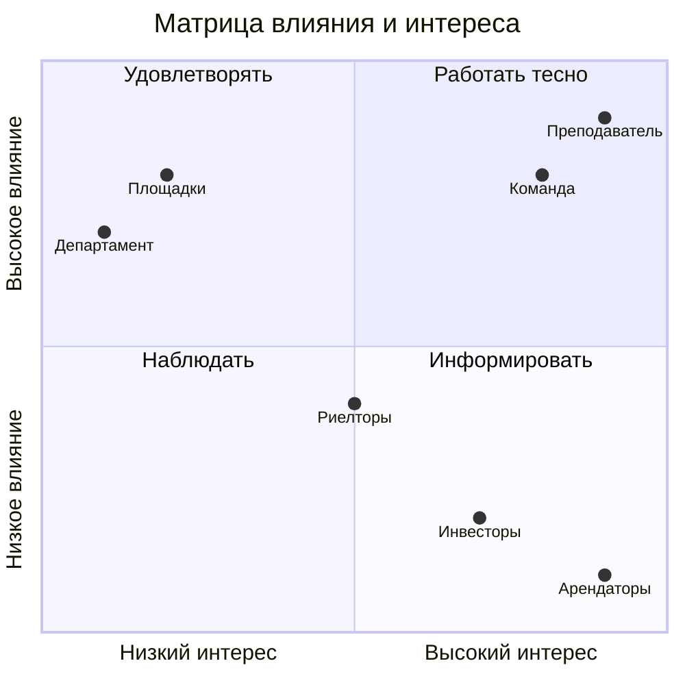

# Стейкхолдеры, матрица влияния и интереса, RACI

<!-- TODO: шаг 4 задания ЛР 1. Минимум 8 стейкхолдеров и 8 работ в RACI. -->

## Реестр
| Стейкхолдер | Роль | Что ожидает | Влияние (1–5) | Интерес (1–5) | Как работаем |
|---|---|---|---|---|---|
| Преподаватель | Заказчик и спонсор | Качественный проект, сданный в срок, соблюдение всех требований | 5 | 5 | Регулярная отчетность, сдача этапов |
| Команда проекта | Менеджер и аналитик | Понятные задачи, успешная защита, хорошая оценка | 5 | 5 | Ежедневная коммуникация, распределение задач |
| Арендаторы | Конечные пользователи | Прозрачные цены, поиск жилья без скрытых условий | 1 | 5 | Учет их потребностей при построении отчета |
| Инвесторы | Конечные пользователи | Понимание доходности и ликвидности сегментов | 2 | 4 | Добавление финансовых метрик в анализ |
| Арендодатели | Поставщики данных | Понимание рыночных ставок для сдачи своей недвижимости | 1 | 4 | Анализ их объявлений |
| Риелторы | Профессиональные участники | Инструмент для быстрого поиска вариантов клиентам | 3 | 3 | Мониторинг их баз, но без прямой интеграции |
| Площадки объявлений (ЦИАН, Авито) | Источники данных | Отсутствие перегрузки серверов | 4 | 1 | Соблюдение лимитов парсинга |
| Департамент городского имущества | Госорган | Отсутствие нарушений законодательства | 4 | 1 | Наблюдение, открытые данные |

## Матрица влияния и интереса
Координаты по осям от 0 до 1.

## RACI
В каждой строке ровно одна буква A.

| Работа | Менеджер проекта (@halcyonmw) | Аналитик (@wwind01) | Тех. организатор (@halcyonmw) | Заказчик (Преподаватель) |
|---|---|---|---|---|
| Устав проекта | A | C | R | I |
| Бизнес-обоснование | A | R | C | I |
| Сбор данных | I | A | R | I |
| Анализ рынка | I | A | R | I |
| Подготовка отчета | A | R | C | I |
| Настройка CI/CD | I | C | A | I |
| Управление рисками | A | R | C | I |
| Защита проекта | R | C | C | A |

## Интервью с заказчиком
Протокол: [docs/meetings/](meetings/)
